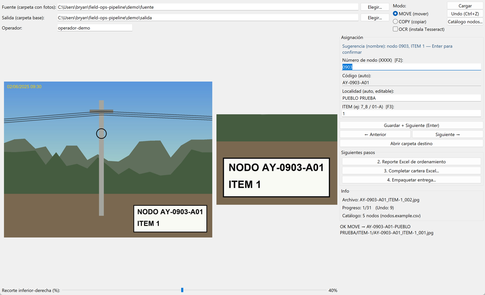
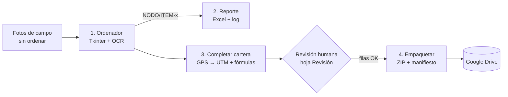
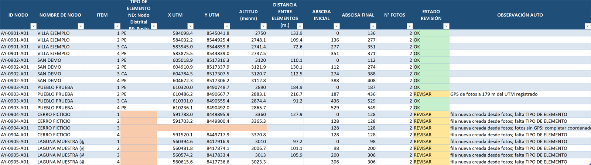

# Field Ops Pipeline

[](https://github.com/SaeBryxn/field-ops-pipeline/actions/workflows/tests.yml)


**De miles de fotos de campo sueltas a una entrega ordenada, con la cartera Excel completada y lista para subir a Drive.**

Automatización (RPA de escritorio) que hice para el área de operaciones de campo de una
empresa de telecomunicaciones. Ordena las fotos de mantenimiento por **NODO** e **ITEM**,
completa la **cartera Excel** con los datos que salen de las propias fotos (GPS → UTM,
altitud, fecha, cantidad de fotos), recalcula las fórmulas técnicas, marca lo que una
persona debe revisar y **empaqueta** todo para la entrega.



> Todos los datos, nodos, localidades y fotos de este repositorio son **ficticios**
> (se generan con `generar_demo.py`). El catálogo real de nodos y las carteras reales
> nunca se suben al repositorio.

---

## El problema

Después de cada campaña de mantenimiento llegaban miles de fotos con nombres de cámara
(`IMG_0001.jpg`, `PHOTO-2025-...jpg`). Hacer la entrega a mano significaba:

1. Abrir foto por foto, leer el rótulo del poste (nodo `AY-XXXX-A01` + ITEM) y moverla a su carpeta.
2. Copiar a la cartera Excel, fila por fila, coordenadas, altitud y datos del nodo.
3. Recalcular distancias entre postes, abscisas, vanos, metros de cable y reservas.
4. Revisar inconsistencias, armar las carpetas y subirlas a Drive.

Para un lote completo eso era **alrededor de un mes de trabajo manual** (con amanecidas), con
errores de tipeo y fotos en la carpeta equivocada que se descubrían tarde. Con la primera
versión de esta herramienta, que hice por iniciativa propia, **pasó a entre 3 días y una semana**.

## La solución



| Paso | Qué hace | Cómo |
|---|---|---|
| **1. Ordenar** | Muestra la foto y un zoom del rótulo; sugiere NODO e ITEM; Enter guarda y pasa a la siguiente | Nombre de archivo (regex) + **OCR con Tesseract** del recorte inferior-derecho. Undo ilimitado |
| **2. Reporte** | Excel con fotos por nodo/ITEM y el log de cada acción (quién, cuándo, a dónde) | `openpyxl` |
| **3. Cartera** | Completa la plantilla Excel: busca la fila `ID NODO + ITEM` o la crea, pone UTM/altitud desde el GPS de las fotos y recalcula las columnas con fórmulas | Motor de reglas que replica las fórmulas de la plantilla; conversión WGS84 → UTM propia (validada contra PROJ) |
| **4. Entregar** | Carpeta `ENTREGA_<fecha>` con fotos, cartera, reporte, `MANIFIESTO.csv` (SHA-256) y ZIP por nodo | Se bloquea si quedan filas sin revisar. Subida opcional con `rclone` |

### La revisión humana es parte del diseño

La herramienta **no reemplaza el criterio del técnico**: hace el trabajo repetitivo y le
deja a una persona solo lo dudoso. Cada fila de la cartera sale como `OK` o `REVISAR`
con el motivo:

- el GPS de las fotos está a más de 50 m del UTM que ya estaba registrado;
- las fotos de un mismo ITEM están dispersas (¿foto en la carpeta equivocada?);
- fotos sin GPS, campos obligatorios vacíos o valores fuera de la lista permitida;
- filas del diseño que se quedaron sin fotos.

Nunca sobrescribe un dato que una persona ya escribió, y nunca modifica la plantilla
original (escribe una copia versionada). El paso 4 no empaqueta hasta que el supervisor
marca `S` en la hoja **Revisión**.



*Cartera de demo: filas en verde completadas automáticamente; en naranja, las que necesitan revisión
(nodos nuevos sin tipo de elemento, una foto sin GPS y un UTM mal digitado detectado a 179 m).*

---

## Instalación

Requisitos: Python 3.11+ en Windows, Linux o macOS.

```bash
git clone https://github.com/SaeBryxn/field-ops-pipeline.git
cd field-ops-pipeline
python -m venv .venv
.venv\Scripts\activate          # Linux/macOS: source .venv/bin/activate
pip install -r requirements.txt
```

**OCR (opcional, recomendado):** instala [Tesseract](https://github.com/UB-Mannheim/tesseract/wiki)
(en Windows: `winget install UB-Mannheim.TesseractOCR`). Si no está instalado, la app funciona
igual con sugerencias por nombre de archivo y entrada manual.

**Catálogo de nodos:** copia `config/nodos.example.csv` a `config/nodos.csv` y pon tus nodos
(`codigo,localidad,departamento,provincia,distrito`). `config/nodos.csv` está en `.gitignore`.

## Uso rápido con datos de demo

```bash
python generar_demo.py            # 40 fotos ficticias + plantilla de cartera en demo/
python main.py                    # 1. ordenar: fuente=demo/fuente, salida=demo/salida
```

O saltar directo a los pasos 2-4 con la demo ya ordenada:

```bash
python generar_demo.py --limpiar --ya-ordenado
python main.py reporte    demo/salida
python main.py cartera    demo/salida --plantilla demo/plantilla_cartera.xlsx
python main.py empaquetar demo/salida            # se detiene: hay filas por revisar
python main.py empaquetar demo/salida --forzar   # o marca "S" en la hoja Revisión
```

Subir a Drive (opcional): configura un remoto una sola vez con `rclone config` y luego
`python main.py empaquetar demo/salida --subir drive:Entregas`. El proyecto no guarda
ninguna credencial; la autenticación con Google la maneja rclone.

### Atajos del ordenador

| Tecla | Acción |
|---|---|
| `Enter` | Guardar (mover/copiar) y pasar a la siguiente |
| `Ctrl+Z` | Deshacer (ilimitado; si fue MOVE la foto vuelve a la fuente y a la lista) |
| `←` / `→` | Foto anterior / siguiente sin guardar |
| `F2` / `F3` | Ir al campo NODO / ITEM |

El último directorio, el % de recorte, el modo y el operador se recuerdan en
`~/.field_ops/config.json`.

---

## Arquitectura

```
field_ops/
├── ui.py            Tkinter: vista previa, recorte del rótulo, OCR en segundo plano
├── nodos.py         catálogo CSV + normalización de "901" / "AY0901A01" → AY-0901-A01
├── rutas.py         nombres de carpeta seguros, ITEM, rutas únicas, escaneo NODO/ITEM
├── undo.py          mover/copiar reversible + pila de Undo
├── ocr.py           sugerencias por nombre de archivo y por Tesseract (tolera O/0, I/1, S/5)
├── imagen.py        orientación EXIF, recortes, lectura de GPS y fecha
├── utm.py           WGS84 → UTM (series de Krüger, sin dependencias)
├── registro.py      log CSV de acciones
├── reporte.py       reporte Excel de ordenamiento
├── cartera/
│   ├── esquema.py   qué columnas son calculadas, numéricas, listas u obligatorias (YAML)
│   ├── reglas.py    fórmulas de la plantilla traducidas a Python
│   ├── motor.py     recálculo por nodo (distancias 3D, abscisas, vanos, cable, reservas…)
│   ├── validador.py reglas de validación
│   ├── excel_io.py  lee/escribe la tabla conservando formato, fórmulas y listas
│   └── completar.py orquesta el paso 3
├── empaquetar.py    entrega + manifiesto SHA-256 + ZIP + rclone
└── cli.py           comandos gui / reporte / cartera / empaquetar / subir
```

Decisiones de diseño:

- **Funciones puras separadas de la interfaz**, para poder testearlas (70 tests con `pytest`,
  incluido un test de OCR real que corre en CI con Tesseract).
- **Configuración fuera del código**: catálogo de nodos en CSV, columnas de la cartera en
  `config/cartera_schema.yml`, variables en `.env` (ver `.env.example`).
- **Nada destructivo**: la plantilla se copia, la entrega copia las fotos y verifica cada copia con SHA-256.
- **El recálculo se hace por nodo**: encadenar el último poste de un nodo con el primero del
  siguiente daba distancias de kilómetros.

## Tests

```bash
pip install -r requirements-dev.txt
pytest
```

## Impacto

| | Antes (manual) | Con la herramienta |
|---|---|---|
| Ordenar fotos de un lote | [X] | [X] |
| Completar la cartera | [X] | [X] + revisión |
| Errores detectados antes de entregar | [X] | [X] |
| Personal necesario | [X] | [X] |

> Completa con tus cifras reales: tiempo por lote, fotos por hora y errores encontrados en revisión.

## Licencia

[MIT](LICENSE)
